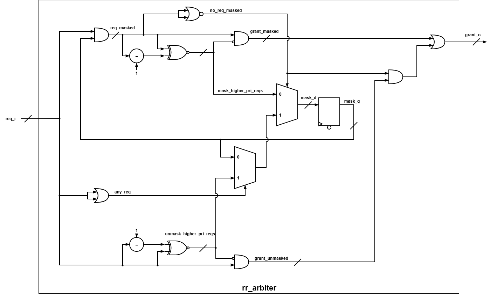

# rr_arbiter

> Parameterizable round-robin arbiter using the mask method with a single-cycle combinational grant.

| Item | Value |
|---|---|
| Version | 1.0 |
| Author | Huy Nguyen |
| Date | October 13, 2026 |

## 1. Overview

The `rr_arbiter` grants a shared resource to one of `NUM_REQ` requesters each cycle, taking turns so that every active requester is served fairly. It implements the mask-based round-robin arbiter described by Matt Weber in *Arbiters: Design Ideas and Coding Styles* (SNUG Boston 2001, Listing 12), which the paper identifies as the fastest, smallest and quickest-to-compile coding style. The round-robin pointer is stored directly as a thermometer mask, so no pointer decoder is needed, and the whole priority logic is written without loops using vector arithmetic.

### 1.1 Features

- **Fair Round-Robin Arbitration:** A requester that has just been granted moves to the lowest priority, so no active requester waits more than `NUM_REQ - 1` cycles.
- **Single-Cycle Combinational Grant:** `grant_o` responds to `req_i` in the same cycle, avoiding the extra-grant problem of registered grant outputs (paper section 2.3).
- **Work-Conserving:** Inactive requesters are skipped; whenever at least one request is active, exactly one grant is issued.
- **Pointer Hold When Idle:** When no requester is active, the pointer keeps its position instead of resetting.
- **Parameterizable Width:** A single parameter `NUM_REQ` scales the design; the logic contains no `for` loops.
- **Low Cost:** Only `NUM_REQ` flip-flops (the mask register) plus combinational logic.

## 2. Architecture

### 2.1 Block Diagram



### 2.2 IO Ports

| Port | Direction | Description |
|---|---|---|
| `clk_i` | input | Clock. |
| `rst_ni` | input | Active-low asynchronous reset. |
| `req_i[NUM_REQ-1:0]` | input | Request vector, one bit per requester (1 = requesting). |
| `grant_o[NUM_REQ-1:0]` | output | One-hot grant vector (all zeros when no request). Combinational from `req_i`. |

### 2.3 Parameters

| Parameter | Default | Description |
|---|---:|---|
| `NUM_REQ` | 16 | Number of requesters (verified for 2, 4, 16 and 64). |

## 3. Functional Description

### 3.1 Mask-Based Round-Robin Arbitration

The arbiter keeps a mask register `mask_q`, where a `1` means "this requester may still be granted in the current round". The design contains two simple priority arbiters that both give priority to the lowest bit index:

- **Masked arbiter:** arbitrates `req_masked = req_i & mask_q`, i.e. only the requesters at or after the round-robin pointer.
- **Unmasked arbiter:** arbitrates the full `req_i`, used for wrap-around when nobody after the pointer is requesting.

The final grant is selected with simple gates:

```systemverilog
grant_o = grant_masked | (grant_unmasked & {NUM_REQ{no_req_masked}});
```

If any masked request exists, the masked arbiter wins; otherwise `grant_masked` is zero and the unmasked arbiter's grant is used.

### 3.2 Loop-Free Priority Logic

Each priority arbiter needs the vector `higher_pri_reqs`, which has a `1` in every bit above the lowest active request. Instead of an OR chain or a `for` loop, it is built with a subtraction:

```systemverilog
higher_pri_reqs = ~(x ^ (x - 1));   // bits above the lowest set bit
grant           = x & ~higher_pri_reqs;   // the lowest set bit
```

Example with `x = 0110`: `x - 1 = 0101`, `x ^ (x - 1) = 0011`, `~ = 1100`, so `grant = 0010` (requester 1). With `x = 0000`, the result is `0000` and no grant is issued.

### 3.3 Pointer Update

After each grant, the next mask is the winning arbiter's `higher_pri_reqs`, which is exactly "every requester above the winner". The winner therefore becomes the lowest priority for the next round (pointer update method 2 of the paper):

| Condition | `mask_d` |
|---|---|
| Masked request exists | `mask_higher_pri_reqs` |
| No masked request, but some request | `unmask_higher_pri_reqs` (wrap-around) |
| No request | `mask_q` (hold) |

Example with `NUM_REQ = 4` and `req_i = 1011` held constant:

| Cycle | `mask_q` | `req_masked` | Winner | `grant_o` | Next `mask_q` |
|---|---|---|---|---|---|
| 0 | 1111 | 1011 | masked | 0001 | 1110 |
| 1 | 1110 | 1010 | masked | 0010 | 1100 |
| 2 | 1100 | 1000 | masked | 1000 | 0000 |
| 3 | 0000 | 0000 | unmasked (wrap) | 0001 | 1110 |

Requester 2 is not requesting and is skipped; requesters 0, 1 and 3 each receive one grant per round.

### 3.4 Reset Behavior

On reset, `mask_q` is set to all ones. The first arbitration after reset behaves like a fixed-priority arbiter, so the lowest-index active requester is granted first.

## 4. Usage

### 4.1 Integration Guide

- **Clock and Reset:** Connect `clk_i` to the clock of the requesting logic and `rst_ni` to its active-low reset. The arbiter is a single-clock design; all requesters must be synchronous to `clk_i`.
- **Requests:** Drive each bit of `req_i` from one requester. Bit 0 has the highest priority after reset.
- **Grants:** `grant_o` is combinational from `req_i` and `mask_q`. Register it in the requester if the downstream path is timing-critical, keeping in mind the interface issues in section 4.2.

### 4.2 Operation Guide

- A requester asserts its `req_i` bit and keeps it high until it sees its `grant_o` bit at a rising edge of `clk_i`. One cycle with the grant high equals one served transaction.
- A requester that keeps `req_i` high continues to receive a grant every turn; it does not need to drop its request between grants.
- The pointer only moves when a grant is issued, so idle cycles do not change the arbitration order.
- If the requester registers `grant_o` before reacting, it may see one extra grant for a single request. Use one of the paper's methods (deassert `req_i` together with the last transfer, an arbiter queue, or credit-based requests) when the request is multi-cycle.

## 5. Verification

Testbench: `sim/tb_rr_arbiter.sv`, a cycle-accurate reference model checked every cycle (one-hot grant, no grant to a non-requester, no idle cycle with active requests, grant equal to the model, starvation bound of `NUM_REQ - 1` cycles). Run with `sim/run_sim.sh`.

| Test | Status | Description |
|---|---|---|
| Reset | PASS | Verifies the mask is all ones after reset and the lowest active requester wins first. |
| No Request | PASS | Verifies no grant is issued and the pointer holds when `req_i` is zero. |
| Single Requester | PASS | Verifies each requester alone is granted every cycle. |
| All Requesting | PASS | Verifies strict rotation 0, 1, ..., `NUM_REQ-1`, 0, ... over two full rounds. |
| Skip Inactive | PASS | Verifies inactive requesters are skipped without wasting a cycle. |
| Wrap Around | PASS | Verifies the pointer wraps from the highest requester back to the lowest. |
| Paper Example | PASS | Reproduces the paper's example: pointer at 2, requesters 7/9/10 arbitrated in order, newly arriving requester 8 granted immediately. |
| FIFO Requesters | PASS | Verifies fairness with queue-driven requesters at ~90% load; every pushed request is granted. |
| Random | PASS | Verifies 3000 cycles of random requests against the reference model. |

Result: `TB_RR_ARBITER: PASS (NUM_REQ=16, 4082 checks, 0 errors)`. Also passes with `NUM_REQ` = 2, 4 and 64.

## 6. Synthesis

| Item | Value |
|---|---|
| Library | Nangate45 |
| Frequency | 100 MHz |
| Configuration | `NUM_REQ = 16` |
| Cell Count | 144 |
| Cell Area | 238.602 |
| WNS | 0.00 ns |

## 7. Notes

**Critical STA Constraint (SDC):**
`grant_o` is combinational from `req_i`, so the design has an input-to-output (I2O) path in addition to the I2R, R2R and R2O paths. The input and output delays together must leave time for the arbiter logic. With `IO_DERATE = 0.6`, the input and output delays consume 120% of the clock period and the I2O path can never meet timing; this IP uses `IO_DERATE = 0.3`, leaving 40% of the period for `req_i -> grant_o`.

**Implementation Notes:**
- The `x - 1` subtraction is equivalent to the paper's OR-chain `higher_pri_reqs` and is mapped by synthesis to a borrow chain; delay grows with `NUM_REQ`.
- `NUM_REQ = 1` has not been verified.
